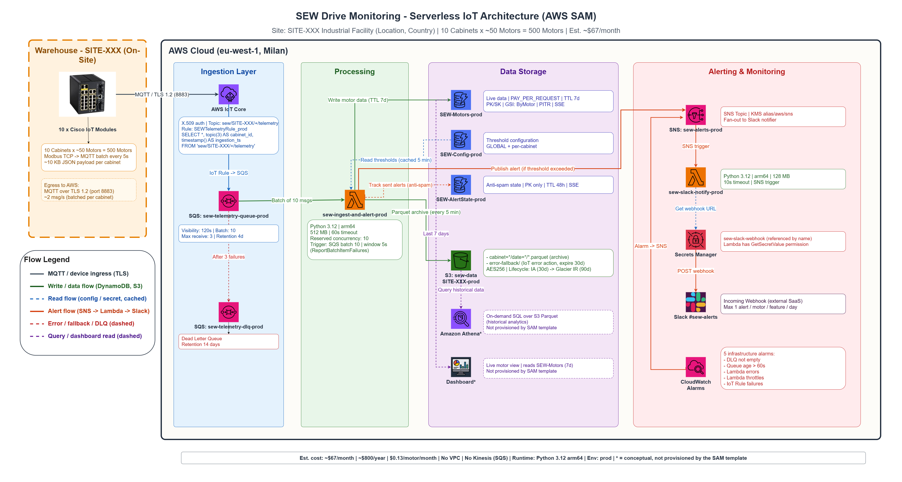
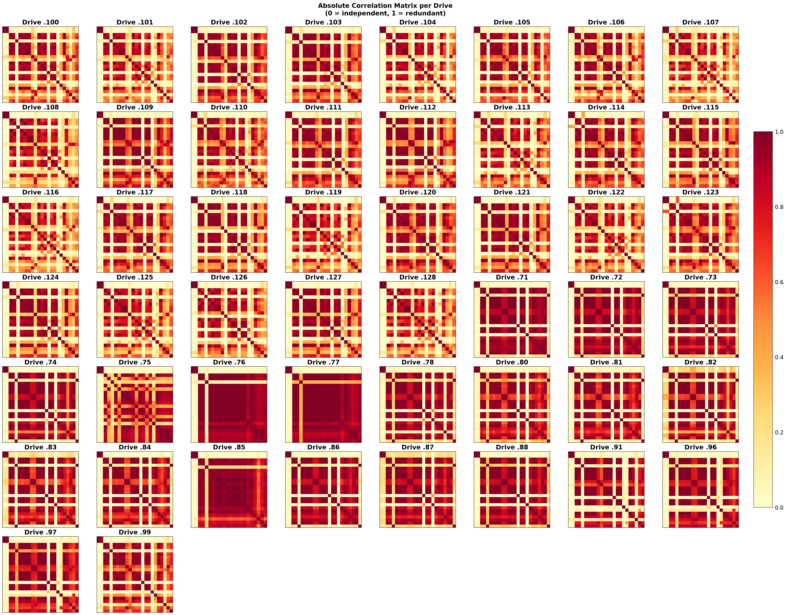
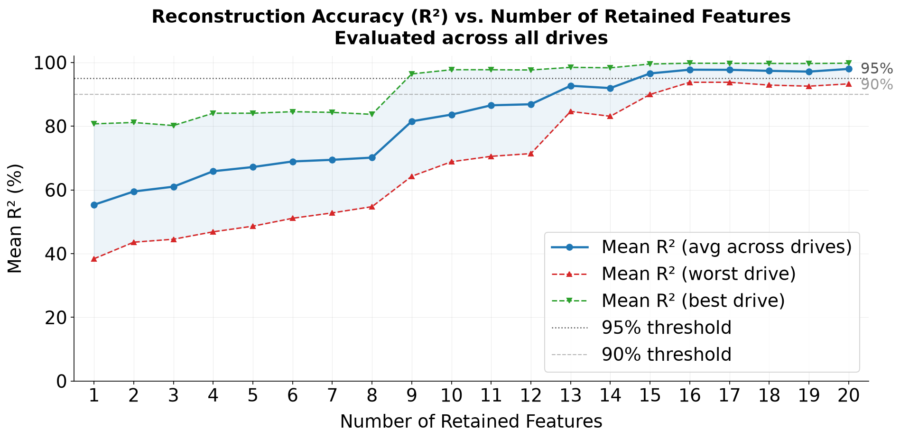

# SEW Drive Monitoring — Industrial IoT Telemetry Analysis

<p align="center">
  
</p>

<p align="center">
  <strong>Serverless IoT pipeline for real-time monitoring, anomaly detection, and data-driven feature engineering on ~500 industrial AC motors.</strong>
</p>

<p align="center">
  
  
  
  
  
</p>

---

## 🔍 The Problem

Industrial facilities run hundreds of AC motors 24/7. Monitoring them traditionally requires on-site visits with handheld tools or expensive SCADA systems. Key challenges:

- **No visibility** — faults go undetected until a motor fails, causing downtime
- **Manual data collection** — engineers physically retrieve data from each drive controller
- **Data overload** — each motor exposes 50+ telemetry parameters; which ones actually matter?
- **Alert fatigue** — naive threshold alerts fire thousands of notifications per day

## 💡 The Solution

A fully **serverless**, **event-driven** pipeline that:

1. **Collects** telemetry from ~500 SEW-Eurodrive MOVIDRIVE motors every 5 seconds via Modbus TCP → MQTT → AWS IoT Core
2. **Ingests & stores** data in DynamoDB (live, 7-day window) and S3 Parquet (long-term archive)
3. **Detects anomalies** using configurable per-motor/per-feature thresholds, evaluated in-memory
4. **Alerts intelligently** via Slack with anti-spam logic (max 1 alert per motor/feature/day)
5. **Reduces dimensionality** from 52 raw columns down to 9 essential features — backed by rigorous statistical analysis

All for **~$67/month** (~$0.13 per motor).

---

## 🏗️ Architecture

The architecture is split into four layers — **Ingestion**, **Processing**, **Storage**, and **Alerting** — all deployed as Infrastructure as Code via a single AWS SAM template.

```
Cisco IoT Modules (10 cabinets × ~50 motors)
        │
        │ MQTT over TLS 1.2 (batched, 2 msg/s)
        ▼
AWS IoT Core (X.509 auth, SQL topic rules)
        │
        │ IoT Rule → SQS (with S3 error fallback)
        ▼
Amazon SQS (buffer, batch of 10, DLQ)
        │
        ▼
AWS Lambda (Python 3.12, arm64)
        │
        ├──▶ DynamoDB (live data, TTL 7d)
        ├──▶ S3 Parquet (long-term, lifecycle tiering)
        └──▶ Threshold Engine (in-memory)
                │
                ▼ anomaly?
        SNS → Lambda → Slack #sew-alerts
```

### Key Design Decisions

| Decision | Rationale |
|---|---|
| **SQS over Kinesis** | At ~2 msg/s, SQS provides equivalent buffering at **98% lower cost** |
| **No VPC** | All services use managed endpoints; security via mTLS + IAM policies |
| **In-memory thresholds** | Avoids $38K/year CloudWatch Custom Metrics cost |
| **Cabinet-level batching** | Reduces IoT Core message costs by **90%** (2 msg/s vs 100 msg/s) |
| **DynamoDB TTL** | Live data auto-expires, keeping storage bounded at ~28 GB |
| **arm64 Lambda** | ~20% better price-performance vs x86 |
| **S3 lifecycle** | Standard → IA (30d) → Glacier IR (90d) for cost-efficient long-term storage |

> 📖 For the full architecture breakdown, see [`docs/architecture.md`](docs/architecture.md)

---

## 📊 Data Analysis — Feature Engineering & Dimensionality Reduction

The analysis pipeline answers a critical question: **out of 52 raw telemetry columns per motor, which ones actually carry useful information?**

### Methodology

Three Jupyter notebooks progressively analyze the data:

| Notebook | Scope | Key Technique |
|---|---|---|
| `01_single_drive_analysis` | 1 drive, deep dive | Correlation matrix, PCA, variance ranking |
| `02_multi_drive_analysis` | 50 drives, 1-hour window | Cross-drive correlation stability |
| `03_extended_analysis` | 50 drives, 6-day window | Multi-method feature selection |

### Feature Selection Methods

The analysis applies and compares **multiple independent methods** to ensure robust feature selection:

- **Correlation clustering** (|ρ| > 0.9) — groups redundant features, keeps highest-variance representative
- **Variance ranking** — eliminates near-constant columns
- **Mutual Information** — captures non-linear dependencies with the target
- **Random Forest reconstruction** — importance scores from ensemble models
- **Laplacian score** — unsupervised, graph-based feature ranking
- **PCA** — identifies the principal components and their explained variance

### Results

| Stage | Features | Variance Retained |
|---|---|---|
| Raw CSV columns | 52 | 100% |
| After constant/duplicate removal | 25 | — |
| **Correlation clustering** | **9** | **96.1%** |
| Multi-method union | 16 | 99.9% |

> 💡 **Key insight**: 9 features are sufficient to capture 96% of the total variance across all 500 motors. The correlation structure is remarkably stable across drives and time windows.

<table>
<tr>
<td width="50%"><br/><em>Correlation matrix across 50 drives — cluster structure is consistent</em></td>
<td width="50%"><br/><em>R² reconstruction score vs number of retained features</em></td>
</tr>
</table>

---

## 💰 Cost Breakdown

For a deployment with ~500 motors, 10 cabinets, polling every 5 seconds:

| Service | Est. Monthly Cost |
|---|---|
| AWS IoT Core | $4–6 |
| SQS | < $1 |
| Lambda (ingest + alert) | $8–12 |
| Lambda (Slack notify) | < $1 |
| DynamoDB (3 tables) | $22–28 |
| S3 (Parquet + lifecycle) | $5–8 |
| SNS + Secrets Manager | < $2 |
| CloudWatch (5 alarms) | $3–5 |
| **Total** | **~$67/month (~$0.13/motor)** |

---

## 🛠️ Tech Stack

| Category | Technologies |
|---|---|
| **Cloud** | AWS IoT Core, Lambda (Python 3.12, arm64), SQS, DynamoDB, S3, SNS, CloudWatch, Secrets Manager, Athena |
| **IaC** | AWS SAM (Serverless Application Model) |
| **Edge** | Cisco IoT Modules, Modbus TCP, MQTT over TLS 1.2 |
| **Analysis** | Python, pandas, NumPy, scikit-learn, Matplotlib |
| **Alerting** | Slack (via webhook) |

---

## 📁 Project Structure

```
sew-drive-analysis/
├── README.md                           # This file
├── .gitignore                          # Git ignore rules
├── docs/
│   ├── architecture.md                 # Full architecture documentation
│   ├── architecture_diagram.png        # Architecture diagram (image)
│   └── architecture_diagram.drawio     # Architecture diagram (editable)
├── infrastructure/
│   └── template.yaml                   # AWS SAM template (IaC)
├── notebooks/
│   ├── 01_single_drive_analysis.ipynb  # Single-drive deep dive
│   ├── 02_multi_drive_analysis.ipynb   # Multi-drive cross-validation (50 drives, 1h)
│   └── 03_extended_analysis.ipynb      # Extended multi-method analysis (50 drives, 6 days)
├── data/
│   ├── README.md                       # Data schema & synthetic data generator
│   └── sample_data.csv                 # Synthetic test data (50 drives × 200 timestamps)
└── assets/
    ├── correlation_grid.png            # Multi-drive correlation matrix
    └── r2_vs_features.png              # R² vs number of features
```

---

## 🚀 Getting Started

### Prerequisites

- AWS CLI configured with appropriate credentials
- [AWS SAM CLI](https://docs.aws.amazon.com/serverless-application-model/latest/developerguide/install-sam-cli.html) installed
- Python 3.12+
- Jupyter Notebook or JupyterLab

### Deploy Infrastructure

```bash
cd infrastructure/
sam build
sam deploy --guided
```

The SAM template is fully parameterized — supports `dev`, `staging`, and `prod` environments with a single deploy command.

### Run Analysis Notebooks

```bash
cd notebooks/
jupyter notebook
```

Start with `01_single_drive_analysis.ipynb` and progress through the series.

> **Note**: A synthetic test dataset (`data/sample_data.csv`) is included so you can run the notebooks immediately. See [`data/README.md`](data/README.md) for the data schema and how to generate your own.

---

## 📄 License

This project is provided for educational and reference purposes.
